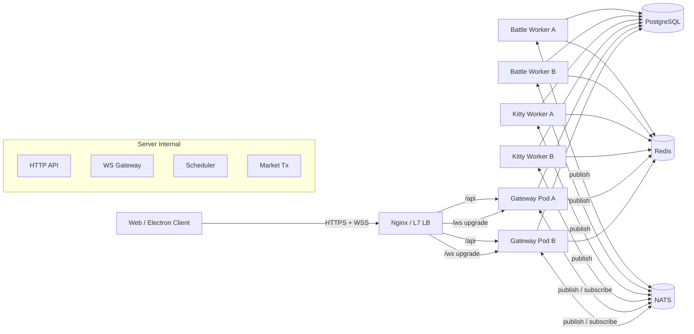

# 多实例可扩展架构（API + WS）

## 当前建议拓扑
1. `Nginx` 统一入口，代理 `/api` 与 `/ws`。
2. 网关与业务 worker 职责分离：网关负责 HTTP/WS，battle-worker 负责战斗推进，kitty-worker 负责猫舍随记/随遇生成。
3. API 状态基于 JWT 无状态校验；数据一致性落 PostgreSQL 事务。
4. WS 连接状态本地化（网关每实例一份），跨实例广播通过 NATS 同步。
5. Redis 承担分布式限流（固定窗口）、在线状态索引等共享状态能力。

## 多实例一致性策略
1. **认证一致性**：所有实例共享 `JWT_SECRET`，API/WS 均用同一 token 校验。
   - 单端登录语义：以 `sessionVersion` 为准，后登录会话踢下旧会话。
2. **业务一致性**：交易/仓库/任务全部以 DB 事务为准，不依赖内存态。
3. **WS 一致性**：节点内 Hub + NATS 广播扇出，支持**全局广播 + 用户定向事件**（`userId` 路由）。
   - `target_users` 优先按 Redis 路由键 `ws:route:user:<userId>` 查到目标节点后走 NATS 节点主题分流。
   - 缺路由时重试 3 次；超限后丢弃并告警（日志 + 指标计数），不回退全局广播。
4. **连接稳定性**：WS 升级后连接绑定单节点；重连后凭 JWT 自动恢复识别。
   - 连接语义为“最新连接生效”：同账号新连接建立后，会向旧连接下发 `auth.kicked` 并断开旧连接。
5. **扩缩容友好**：新增实例只需注册到 LB，不要求前端修改。
6. **在线状态一致性**：presence 以“当前有效 `sessionVersion` 连接活跃度”派生，不直接信任持久化 `status`；连接键使用短 TTL 收敛僵尸在线。
7. **战斗事件归口**：battle-worker 仅发布 `battle.run.batch`（NATS），gateway 统一订阅并转发 WS；不再由 worker 直接承担客户端连接语义。
8. **离线投递策略**：gateway 对 WS 事件做分类投递（`global_broadcast` / `must_deliver_control` / `user_state`）；用户离线时仅放行前两类，用户态增量（含 battle batch）统一拦截。
9. **战斗横向扩展**：battle-worker 通过 `battle_rooms.owner_worker_id + lease_until + next_tick_at` 自动认领房间并续租；推进循环按最早 `next_tick_at` 动态唤醒，不依赖固定轮询；新增实例后无需手工分片参数即可自动参与负载。

## WS 并发写与背压约束（强制）
1. 同一 `websocket.Conn` 仅允许单写协程执行 `WriteJSON`。
2. 业务路径只允许“消息入队”，禁止在请求协程/回调协程直接写 socket。
3. 每连接发送队列为有界容量（默认 64）；满队列时关闭慢连接，优先保护系统稳态。

## WS 事件分类与扩展（新增）
1. 必达消息（`must_deliver_control`）采用集中注册表维护，新增事件只改注册表与测试，不改主投递流程。
2. 默认未知事件按 `user_state` 处理，避免误放行。
3. 建议采集 offline 拦截计数与放行计数（按 eventType），用于回归与容量评估。

## 跨实例广播可用性（强制）
1. NATS 不可用时，后端应启动失败，避免静默降级为“仅本实例广播”。
2. 启动日志需明确广播主题与连接状态，便于快速判定集群广播健康度。
3. 建议启用 `WS_TARGETED_ROUTING_ENABLED=true` 后再灰度观察定向分流命中率。

## 纯自建 Nginx 动态扩容
1. 后端实例通过 Redis 心跳 key（`ws:backend:node:<ip:port>`）注册存活状态。
2. Nginx 同步器周期读取活跃节点并刷新 upstream include，再平滑 reload。
3. WS 路由保持一致性哈希（token 优先，fallback remote addr），保障连接粘性。

## 超大离线快进约束（Action Queue）
1. 快进应采用“按 queue 聚合结算”，避免单步回放导致写放大。
2. 结算必须保持队列顺序与门槛语义：前序完成后再检查后序动作是否可启动。
3. 随机奖励采用批采样聚合写入，避免大离线时数据库产生海量小写操作。
4. 离线快进必须有执行预算与超时边界；超时时返回可识别错误事件，避免阻塞登录与主状态同步。
5. 运行时请求链路禁止执行 schema 变更（DDL）；schema 调整只在启动迁移阶段执行，避免锁竞争导致实例卡死。
6. 离线快进触发标记需放在共享存储（Redis），并使用原子消费语义（如 `GETDEL`）确保跨实例一次性结算。

## 请求防重放（API + WS）
1. **HTTP 写请求**：统一携带 `X-Idempotency-Key`，服务端做短窗口去重（优先 Redis `SETNX`）。
2. **WS 写消息**：统一携带 `requestId`，服务端对 mutating 消息做去重窗口校验。
3. **错误语义**：重复请求返回可识别错误码（如 `REQUEST_DUPLICATE` / `WS_DUPLICATE_REQUEST`）。

## 全局实时订阅原则（前端）
1. 关键实时链路（队列拉取、库存/仓库/玩家状态订阅）在全局层（Shell/Store）启动。
2. 业务页面只消费全局状态，不负责启动关键实时流程。
3. 避免“先进入某页面才触发更新”的隐式耦合。

## 装备领域事件（新增）
1. `equipment.instances.updated`：当前已装备实例快照（含槽位标记）。
2. `equipment.stats.updated`：装备相关基础属性/派生属性快照。
3. 约束：装备中的实例 `state='equipped'`，不可进入商店/市场/拍卖交易链路；仅 `state='inventory'` 可交易。

## 限流与重置（Redis）
1. 请求限流键按场景隔离（`api/register/login/login-attempt`）。
2. 计数与 TTL 存在 Redis，确保多实例统一生效。
3. 运维重置通过删指定 key 范围完成（例如灰度封禁解除），无需重启实例。

## 微服务是否更好
- 对你当前阶段，优先建议：**模块化单体 + 多实例 + 清晰边界**。
- 当出现以下信号再拆微服务更划算：
  1. 市场交易、调度、聊天的发布节奏与资源需求明显分离；
  2. 单仓库发布窗口成为瓶颈；
  3. 团队已具备服务治理（观测、熔断、配置中心、链路追踪）能力。

## ActionQueue 新约束（通用队列内核）
1. actionQueue 仅承载通用能力（排队/调度/抢占/状态机/幂等编排），不承载具体业务结算规则。
2. 业务通过 `action_type + payload` 分发到 handler：`validate/start/settleOnce/settleFastForward/cancel`。
3. 多实例推进使用 `next_process_at + Redis due_users + worker`，事务内使用 `pg_advisory_xact_lock(player_id)` 做单玩家串行。
4. 快进预算统一来自 `global-config.json`：
   - `actionQueue.fastForward.maxSteps`
   - `actionQueue.fastForward.maxExecMs`
